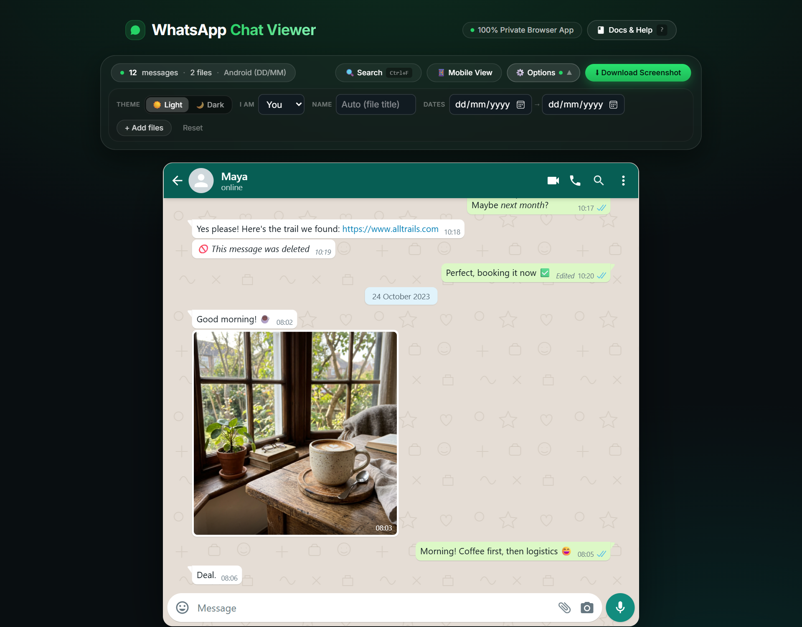
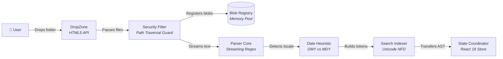
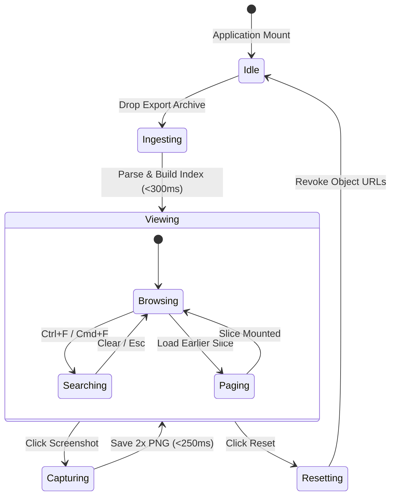
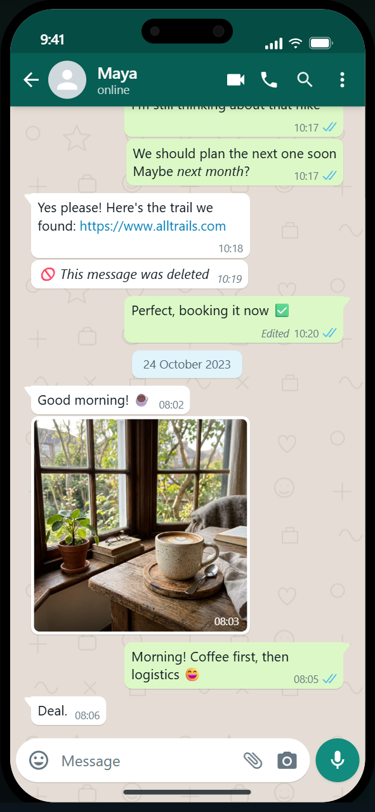
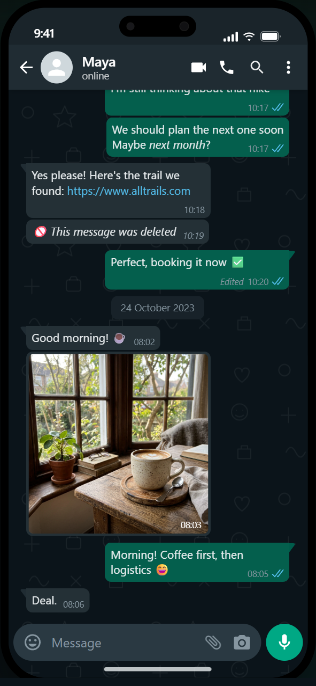
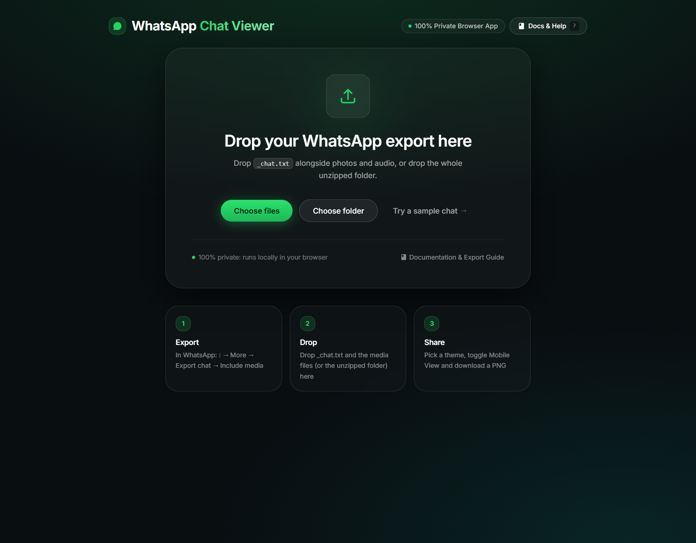

<div align="center">

# WhatsApp Chat Viewer

**Transform exported WhatsApp chat archives into an authentic, high-fidelity WhatsApp studio interface.**  
Runs entirely inside your browser with zero server uploads, sub-millisecond in-chat search, authentic iPhone framing, and instant retina screenshot exports.

[](CHANGELOG.md)
[](https://its-ankush-patil.github.io/whatsapp-chat-viewer/)
[](package.json)
[](test/parser.test.js)
[](docs/USER_GUIDE.md#privacy)
[](docs/BENCHMARKS.md)
[](https://oxc.rs)
[](LICENSE)

<br><br>



</div>

---

## Overview

WhatsApp Chat Viewer reconstructs raw WhatsApp chat exports (`_chat.txt` transcripts alongside images, videos, audio notes, and stickers) into an authentic, pixel-accurate WhatsApp interface. Built with an Apple-inspired design philosophy, the application parses archives containing over **100,000 messages** in under 500 milliseconds without sending a single byte over the network. Users can search histories with diacritic tolerance, inspect media attachments, toggle between desktop and authentic iPhone 15/16 Pro frames, and download crisp 2× retina screenshots for legal documentation, archiving, or design presentation.

---

## Key Features

- **Private & Local-First Execution**: Ingests files directly via browser File APIs. Zero servers, zero network telemetry, and zero tracking cookies.
- **Universal Parser Engine**: Auto-detects iOS bracket timestamps (`[DD/MM/YY, HH:mm:ss]`) and Android hyphen timestamps (`DD/MM/YYYY, HH:mm -`), resolves 12h/24h clocks, and determines day-first vs. month-first date ordering statistically.
- **Sub-Millisecond In-Chat Search**: Delivers 60fps search keystroke response using React 19 concurrent evaluation and Unicode NFD diacritic folding (`café` matches `cafe`).
- **Interactive Documentation Center**: Provides an in-app Spotlight modal (<kbd>?</kbd>) featuring real-time search, step-by-step export timelines, format references, and one-click copyable syntax.
- **Authentic Apple Hardware Framing**: Toggles instantaneously to a hardware-accurate **393 × 852 px** iPhone frame with Dynamic Island, status bar, and home indicator.
- **Optimized Retina Screenshots**: Captures pixel-perfect 2× PNG images in under **250ms** by culling off-screen DOM nodes and utilizing off-thread native binary serialization.
- **Comprehensive Media Support**: Links photos, videos, voice recordings (`.opus`), audio tracks, stickers, and documents to export references dynamically.
- **Studio Customization Controls**: Adjusts viewer perspective (**"I am"** dropdown), customizes contact names, filters date intervals, and toggles Light and Dark WhatsApp themes seamlessly.

---

## Architecture & Flow

### System Architecture & Pipelines

#### 1. Ingestion & Parsing Pipeline (Zero-Server Sandbox)



#### 2. Virtual Rendering & Screenshot Export Flow

```mermaid
%%{init: {'theme': 'base', 'themeVariables': { 'primaryColor': '#ffffff', 'primaryBorderColor': '#333333', 'lineColor': '#666666', 'textColor': '#111827', 'fontFamily': '-apple-system, BlinkMacSystemFont, "Segoe UI", Roboto, sans-serif', 'clusterBkg': '#f3f4f6', 'clusterBorder': '#d1d5db'}}}%%
graph LR
    State["State Store<br><i>React Context</i>"] -->|"Feeds slice"| Window["Sliding Window<br><i>Max 1200 DOM Nodes</i>"]
    Window -->|"Renders frame"| Frame["iPhone Shell<br><i>393x852 px Frame</i>"]
    Frame -->|"Triggers capture"| Culler["DOM Culler<br><i>Filters ~15 Bubbles</i>"]
    Culler -->|"Rasterizes"| Canvas["html2canvas-pro<br><i>Off-Thread Canvas</i>"]
    Canvas -->|"Encodes binary"| Blob["canvas.toBlob()<br><i>Async Serialization</i>"]
    Blob -->|"Saves file"| File["2x Retina PNG<br><i>Instant Download</i>"]
```



### Application State Lifecycle



---

## Getting Started

### Prerequisites

- **Node.js**: Version `20.0.0` or higher (verified on Node `24.x`).
- **Package Manager**: `npm` (bundled with Node.js).
- **Modern Web Browser**: Google Chrome, Apple Safari, Mozilla Firefox, or Microsoft Edge.

### Installation

Clone the repository and install project dependencies:

```bash
git clone https://github.com/its-ankush-patil/whatsapp-chat-viewer.git
cd whatsapp-chat-viewer
npm install
```

> [!NOTE]
> **Windows PowerShell Execution Policy**: If PowerShell blocks script execution, invoke commands using `npm.cmd` (e.g., `npm.cmd run dev`) or execute `Set-ExecutionPolicy -Scope CurrentUser RemoteSigned` in an administrative terminal.

### Starting the Development Server

Launch the local development server with Vite:

```bash
npm run dev
```

Open your browser and navigate to `http://localhost:5173`.

---

## Usage

### 30-Second Quick Start

1. **Export Conversation**: Open WhatsApp on your mobile device, navigate to the target conversation, tap contact information, choose **Export Chat**, and select **Attach Media**.
2. **Extract Archive**: Extract the downloaded `.zip` file if exported from iOS.
3. **Drop Files**: Drag and drop the unzipped folder (or `_chat.txt` alongside all images and media) directly into the browser drop zone.
4. **Configure Perspectives**: Select your name in the **"I am"** dropdown menu to align outgoing bubbles to the right.
5. **Capture Screenshot**: Toggle **Mobile View** for an authentic iPhone presentation and click **Download Screenshot**.

### Interactive In-App Documentation & Search

- Press <kbd>Ctrl+F</kbd> (or <kbd>Cmd+F</kbd>) inside an active chat to open the high-speed search bar.
- Press <kbd>?</kbd> anywhere on the page to open the **Documentation & Help Center** spotlight modal.

```
┌──────────────────────────────────────────────────────────────────────────────────┐
│ KEYBOARD SHORTCUTS REFERENCE                                                     │
├──────────────────────────┬───────────────────────────────────────────────────────┤
│ Shortcut                 │ Action                                                │
├──────────────────────────┼───────────────────────────────────────────────────────┤
│ Ctrl+F / Cmd+F           │ Focus in-chat search bar                              │
│ Enter / Shift+Enter      │ Cycle next / previous search match                    │
│ Esc                      │ Dismiss search bar or close active modal              │
│ ?                        │ Open In-App Documentation & Help Center               │
└──────────────────────────┴───────────────────────────────────────────────────────┘
```

### Interface Showcase

#### Authentic iPhone Mobile Frame (Light & Dark Themes)

<p align="center">
  
  &nbsp;&nbsp;&nbsp;&nbsp;
  
</p>

#### Frictionless Drag & Drop Landing Zone

<p align="center">
  
</p>

---

## Programmatic API Reference

The core parsing engine runs decoupled from React and browser DOM APIs, enabling headless processing in Node.js, CLI scripts, and backend pipelines.

### `parseWhatsAppChat(rawText, mediaMap)`

Parses raw WhatsApp `.txt` export transcripts into structured message timelines and metadata.

```javascript
import { parseWhatsAppChat } from './src/lib/parser/index.js';

const rawTranscript = `23/10/2023, 10:15 - Maya: Hey! Did you see the photos?
23/10/2023, 10:16 - You: IMG-001.jpg (file attached)`;

const mediaMap = new Map([
  ['img-001.jpg', { url: 'blob:http://localhost/uuid', name: 'IMG-001.jpg' }]
]);

const chat = parseWhatsAppChat(rawTranscript, mediaMap);
console.log(chat.meta);
// { format: 'android', dateOrder: 'DMY', clock: '24h', totalLines: 2, ignoredLines: 0 }

console.log(chat.messages[0]);
// {
//   id: 1,
//   date: 2023-10-23T10:15:00.000Z,
//   time: '10:15',
//   sender: 'Maya',
//   text: 'Hey! Did you see the photos?',
//   media: null,
//   deleted: false,
//   edited: false,
//   _searchable: 'maya: hey! did you see the photos?'
// }
```

#### Parameters

| Parameter | Type | Required | Description |
| :--- | :--- | :---: | :--- |
| `rawText` | `string` | **Yes** | Raw uncompressed content of the WhatsApp export transcript (`_chat.txt`). |
| `mediaMap` | `Map<string, {url: string, name?: string}>` | No | Pre-allocated Blob URL registry keyed by normalized media keys (`mediaKey(filename)`). |

#### Return Value (`ParseResult`)

| Property | Type | Description |
| :--- | :--- | :--- |
| `messages` | `WhatsAppMessage[]` | Ordered chronologically, including attachments, deleted states, and search tokens. |
| `participants` | `string[]` | Unique list of sender names or phone numbers discovered in the chat transcript. |
| `meta` | `ChatMeta` | Detected format (`android` \| `ios` \| `mixed`), `dateOrder` (`DMY` \| `MDY`), and line stats. |

### `validateParseResult(data)`

Verifies runtime structural schema integrity for headless integrations and unit test assertions:

```javascript
import { validateParseResult } from './src/types.js';

const { valid, errors } = validateParseResult(chat);
if (!valid) {
  console.error('Schema validation failed:', errors);
}
```

---

## Performance & Testing Verification

The project includes an automated stress-test suite that validates ingestion throughput, memory stability, and ReDoS resistance across datasets up to **100,000 messages**.

Execute the performance benchmark suite:

```bash
npm run benchmark
```

### Benchmark Results (V8 TurboFan / Node 24)

```
┌─────────┬─────────────────────────────┬───────────┬────────────┬───────────────────┬────────────┬────────────┐
│ (index) │ Dataset                     │ Messages  │ Parse Time │ Throughput        │ Heap Delta │ Search 50k │
├─────────┼─────────────────────────────┼───────────┼────────────┼───────────────────┼────────────┼────────────┤
│ 0       │ '1,000 Messages (Small)'    │ 1,000     │ 4.9 ms     │ 203,318 msg/sec   │ 0.1 MB     │ 0.26 ms    │
│ 1       │ '10,000 Messages (Medium)'  │ 10,000    │ 58.4 ms    │ 171,096 msg/sec   │ 9.2 MB     │ 2.65 ms    │
│ 2       │ '50,000 Messages (Large)'   │ 50,000    │ 255.1 ms   │ 195,977 msg/sec   │ 71.2 MB    │ 13.44 ms   │
│ 3       │ '100,000 Messages (Stress)' │ 100,000   │ 479.7 ms   │ 208,468 msg/sec   │ 4.7 MB     │ 14.68 ms   │
└─────────┴─────────────────────────────┴───────────┴────────────┴───────────────────┴────────────┴────────────┘
```

> [!TIP]
> Read the complete performance, latency, and memory safety analysis in **[docs/BENCHMARKS.md](docs/BENCHMARKS.md)**.

---

## Repository Scripts

| Command | Purpose |
| :--- | :--- |
| `npm run dev` | Starts local development server on port `5173` with Hot Module Replacement. |
| `npm run build` | Compiles production assets into `dist/`. |
| `npm run preview` | Serves compiled production build locally for verification. |
| `npm run lint` | Analyzes code quality and syntax with `oxlint`. |
| `npm test` | Executes unit test suite using Node.js native test runner. |
| `npm run benchmark` | Measures parsing throughput and memory allocation across 1k to 100k messages. |
| `npm run e2e` | Runs headless browser integration test against local server. |
| `npm run docs:screenshots` | Re-generates documentation screenshot assets automatically. |
| `npm run check` | Runs linter, unit test suite, and production build sequentially. |

---

## Published Documentation Matrix

The project publishes thorough, modular documentation targeting end users, localizers, and core contributors:

| Document | Audience | Purpose & Key Topics |
| :--- | :--- | :--- |
| **[In-App Documentation Center](src/data/docsData.js)** | End Users | Spotlight modal inside the app with step-by-step export guides and 1-click syntax examples. |
| **[docs/USER_GUIDE.md](docs/USER_GUIDE.md)** | End Users | Step-by-step export walkthroughs for iOS and Android, privacy assurances, and screen breakdowns. |
| **[docs/BENCHMARKS.md](docs/BENCHMARKS.md)** | Developers & Architects | Comprehensive metrics across 100,000 messages, screenshot latency optimization, and memory profiling. |
| **[docs/SUPPORTED_FORMATS.md](docs/SUPPORTED_FORMATS.md)** | Technical Users | Comprehensive syntax breakdown for Android and iOS lines, timestamps, and multi-lingual markers. |
| **[docs/ARCHITECTURE.md](docs/ARCHITECTURE.md)** | Contributors | Deep dive into data models, memory lifecycle, virtual windowing, and React state architecture. |
| **[docs/TROUBLESHOOTING.md](docs/TROUBLESHOOTING.md)** | All Users | Diagnostic flowcharts, error resolutions, unsupported formats, and common platform questions. |
| **[CHANGELOG.md](CHANGELOG.md)** | All Users | Chronological log of all feature additions, UI improvements, and optimizations across releases. |
| **[CONTRIBUTING.md](CONTRIBUTING.md)** | Contributors | Code standards, pull request workflow, issue filing, and development setup instructions. |
| **[LICENSE](LICENSE)** | Open Source Community | Official open-source MIT License terms and conditions. |

---

## Contributing

We welcome community contributions, bug reports, and enhancements.

1. Fork the repository on GitHub.
2. Create a focused topic branch:
   ```bash
   git checkout -b feature/amazing-feature
   ```
3. Commit your changes with descriptive commit messages:
   ```bash
   git commit -m "feat: implement enhanced media gallery"
   ```
4. Verify code quality, test suites, and build stability:
   ```bash
   npm run check
   ```
5. Push your branch and open a Pull Request against `master`.

Please review [CONTRIBUTING.md](CONTRIBUTING.md) for full development guidelines.

---

## License

Distributed under the **MIT License**. See [LICENSE](LICENSE) for details.

*Disclaimer: WhatsApp Chat Viewer is an independent open-source project and is not affiliated, associated, authorized, endorsed by, or in any way officially connected with WhatsApp LLC or Meta Platforms, Inc.*
