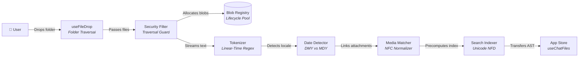
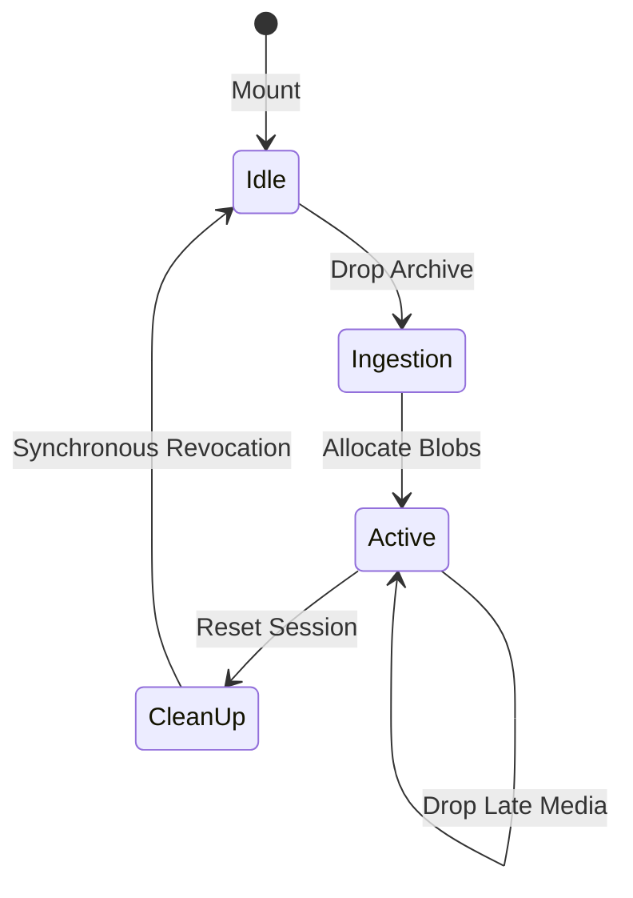
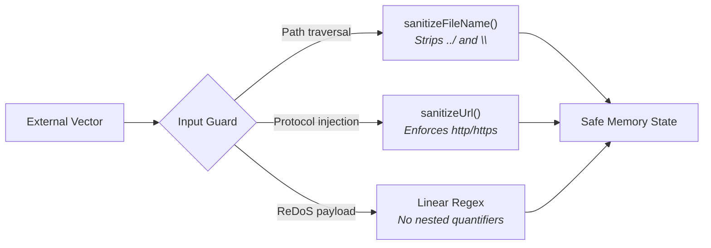

# 🏛️ Architecture & Technical Design

This document details the architectural principles, client-side data pipelines, memory lifecycle management, and design patterns powering **WhatsApp Chat Viewer**.

---

## 1. High-Level System Architecture

WhatsApp Chat Viewer operates as a **100% client-side Single Page Application (SPA)**. Files, chat histories, and media attachments never touch an external server or telemetry collector.

### 1.1 Ingestion & Parsing Pipeline (Decoupled Pure JS)



### 1.2 Presentation & Graphics Pipeline (React 19)

```mermaid
%%{init: {'theme': 'base', 'themeVariables': { 'primaryColor': '#ffffff', 'primaryBorderColor': '#333333', 'lineColor': '#666666', 'textColor': '#111827', 'fontFamily': '-apple-system, BlinkMacSystemFont, "Segoe UI", Roboto, sans-serif', 'clusterBkg': '#f3f4f6', 'clusterBorder': '#d1d5db'}}}%%
graph LR
    State["App State Store<br><i>Chat Session</i>"] -->|"Feeds slice"| Window["Sliding Window<br><i>Max 1200 DOM</i>"]
    Window -->|"Renders UI"| Shell["Device Frame<br><i>iPhone or Desktop</i>"]
    Shell -->|"Triggers capture"| Optimizer["DOM Culler<br><i>Filters ~15 Bubbles</i>"]
    Optimizer -->|"Rasterizes"| Canvas["html2canvas-pro<br><i>Off-Thread Vector</i>"]
    Canvas -->|"Serializes"| Blob["canvas.toBlob()<br><i>Async Binary</i>"]
    Blob -->|"Downloads file"| File["Retina PNG<br><i>Instant Download</i>"]
```



---

## 2. Directory Layout & Module Responsibilities

```text
whatsapp-chat-viewer/
├── src/
│   ├── lib/
│   │   ├── parser/            # Core Parsing Engine (pure JS, decoupled from DOM)
│   │   │   ├── patterns.js    # Strict linear-time RegEx (iOS, Android, timestamps)
│   │   │   ├── datetime.js    # Statistical DMY vs MDY date order detection
│   │   │   ├── media.js       # International attachment marker resolution
│   │   │   └── index.js       # Main parseWhatsAppChat entrypoint
│   │   ├── files.js           # Directory reader & file tree flattener
│   │   ├── formatText.jsx     # WhatsApp inline syntax (*bold*, _italic_, ~strike~, links)
│   │   ├── screenshot.js      # html2canvas-pro wrapper with viewport culling & toBlob
│   │   ├── themes.js          # WhatsApp light & dark theme token definitions
│   │   └── sample.js          # Built-in demo conversation loader
│   ├── hooks/
│   │   ├── useChatFiles.js    # File state, text caching, and blob URL lifecycle
│   │   └── useFileDrop.js     # Window drag-and-drop listener & directory traversal
│   ├── data/
│   │   └── docsData.js        # Searchable documentation dataset with step timelines
│   ├── components/
│   │   ├── DropZone.jsx       # Landing card with drag-and-drop & folder picker
│   │   ├── Toolbar.jsx        # Apple status pill, compact studio ribbon, options drawer
│   │   ├── DocsModal.jsx      # Apple Spotlight-style documentation modal (<kbd>?</kbd>)
│   │   ├── DocArticleView.jsx # Rich documentation article renderer with timeline steps
│   │   ├── ChatWindow.jsx     # Authentic iPhone frame (393×852 px) or Desktop window
│   │   ├── ChatHeader.jsx     # Dynamic Island, iOS status bar, contact profile
│   │   ├── ChatBody.jsx       # Virtual windowed message list with bubble tails
│   │   ├── ChatFooter.jsx     # Authentic WhatsApp microphone & message composer
│   │   └── Icons.jsx          # Crisp inline SVG vector icons
│   ├── App.jsx                # Top-level state orchestration & keyboard listeners
│   └── index.css              # Apple SF Pro system typography & Tailwind styling
├── scripts/
│   ├── benchmark.mjs          # Stress-test benchmark runner (1k to 100k msgs)
│   ├── e2e.mjs                # 17-step headless browser integration runner
│   └── capture-docs.mjs       # Automatic visual documentation capture
└── docs/                      # Architectural guides, benchmarks, and user specs
```

---

## 3. Core Architectural Decisions

### 3.1 Pure JS Parser Engine (`src/lib/parser/`)
* **Decoupled from DOM/React:** The parser has zero dependencies on browser APIs. It accepts a raw string and an optional `Map<string, File>` and outputs an immutable chat structure.
* **Unit Testable:** Runs directly in standard Node.js environments (`npm test`) in milliseconds.
* **Two-Pass Algorithm:**
  1. *Pass 1 (Stream Analysis):* Aggregates multi-line continuations, tracks timestamp distributions, and verifies date ordering (`DMY` vs `MDY`).
  2. *Pass 2 (Entity Extraction):* Splits senders, extracts media markers, formats deleted/edited statuses, and produces pre-normalized NFD search indices (`_searchable`).

### 3.2 Memory Safety & Object URL Lifecycle



* Browser heap exhaustion is prevented by managing all `blob:` URLs in a centralized registry.
* Whenever a new chat is dropped or the user clicks **Reset**, every active Object URL is revoked synchronously.

### 3.3 Virtual Windowing & UI Performance
* **Windowed Pagination:** Renders the latest 400 messages initially, with a "Load 400 earlier messages" button that expands the list smoothly.
* **Non-Blocking Search:** Keystrokes inside the search bar are processed concurrently using React 19's `useDeferredValue()`, ensuring 60fps input responsiveness even with 50,000 messages.
* **Viewport Culling for Screenshots:** During PNG capture, off-screen DOM nodes are excluded, reducing rasterization overhead by ~95%.

### 3.4 Security Boundaries & Threat Modeling

WhatsApp Chat Viewer operates under an uncompromising zero-trust client privacy model:



1. **Zero Outbound Network Traffic**: The application transmits zero network requests, telemetry, or analytics. Chat transcripts and images reside strictly within the user's browser runtime.
2. **Path Traversal Defense**: All attachment markers extracted from chat transcripts (`(file attached)` or `<attached: ...>`) undergo `sanitizeFileName()` sanitization, removing POSIX and Windows relative path traversals (`../`, `..\`) and null bytes before indexing.
3. **Protocol Whitelisting**: Hyperlinks detected within message bodies are parsed with the native `URL` constructor and restricted strictly to `http:` and `https:`. Malformed or non-whitelisted protocols fall back safely to inert plain text.
4. **Linear ReDoS Guarantees**: Every regular expression in `patterns.js` operates in linear $O(N)$ time, preventing browser freezes even when evaluating pathological input strings.

