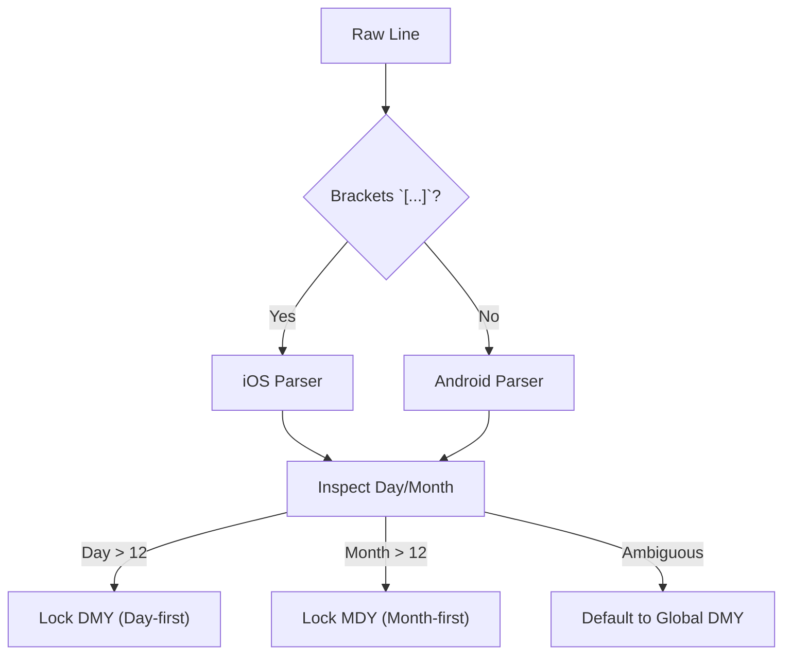

# 🌐 Supported Formats & Parsing Specifications

This document outlines all WhatsApp export formats, date/time variations, media marker notations, and special message types handled by the parser engine in `src/lib/parser/`.

---

## 1. Line Formats by Operating System

WhatsApp exports chat histories as plain `.txt` files with structure determined by the operating system of the exporting device and system locale.

### 🤖 Android Line Format
* **Syntax:** `DD/MM/YYYY, HH:mm - Sender: Message`
* **Real-World Example:**
  ```text
  23/10/2023, 10:15 - Maya: Hey! Did you see the photos from yesterday?
  ```
* **Key Characteristics:**
  * No surrounding brackets on the timestamp.
  * Separated by a hyphen surrounded by spaces (` - `).
  * Supports 12-hour (with AM/PM) or 24-hour time notations.

### 🍏 iOS (iPhone & iPad) Line Format
* **Syntax:** `[DD/MM/YY, HH:mm:ss] Sender: Message`
* **Real-World Example:**
  ```text
  [23/10/23, 10:15:30] Maya: Hey! Did you see the photos from yesterday?
  ```
* **Key Characteristics:**
  * Surrounded by brackets `[...]`.
  * Seconds are frequently included (`:ss`).
  * Often contains invisible Unicode directional marks (LRM `\u200E`, RLM `\u200F`, BOM `\uFEFF`) and narrow non-breaking spaces (`\u202F`). The parser sanitizes these prior to evaluation.

---

## 2. Date & Time Parsing Engine



### Date Formats Supported
* `DD/MM/YYYY` / `DD/MM/YY` (Day-first, standard European & Global)
* `MM/DD/YYYY` / `MM/DD/YY` (Month-first, US standard)
* `YYYY-MM-DD` / `YYYY/MM/DD` (ISO 8601 standard)
* `DD.MM.YYYY` / `DD.MM.YY` (German, Swiss, Nordic dot notation)
* `DD-MM-YYYY` (Hyphenated notation)

### Time Formats Supported
* **24-hour:** `14:30`, `09:15:42`, `14.30`
* **12-hour with AM/PM:** `2:30 PM`, `09:15:42 AM`, `10:15pm`
* **Spanish / Regional variations:** `10:15 p. m.`, `09:30 a. m.`
* **Narrow No-Break Spaces:** Handles `\u202F` before AM/PM seamlessly.

---

## 3. Media Attachments & International Locale Markers

When exporting with media, WhatsApp replaces the media payload in the `.txt` transcript with an attachment reference and exports physical files into the same directory or archive.

```
┌────────────────────────────────────────────────────────────────────────────────────────┐
│                        ATTACHMENT MARKER FORMATS BY LOCALE                             │
├───────────────┬─────────────────┬──────────────────────────────────────────────────────┤
│ Platform      │ Locale          │ Syntax Pattern in Export .txt                        │
├───────────────┼─────────────────┼──────────────────────────────────────────────────────┤
│ 🤖 Android    │ 🇬🇧 English      │ <filename> (file attached)                           │
│ 🤖 Android    │ 🇩🇪 German       │ <filename> (Datei angehängt)                         │
│ 🤖 Android    │ 🇪🇸 Spanish      │ <filename> (archivo adjunto)                         │
│ 🤖 Android    │ 🇫🇷 French       │ <filename> (fichier joint)                           │
│ 🤖 Android    │ 🇮🇹 Italian      │ <filename> (file allegato)                           │
│ 🤖 Android    │ 🇧🇷 Portuguese   │ <filename> (arquivo anexado)                         │
│ 🤖 Android    │ 🇳🇱 Dutch        │ <filename> (bestand bijgevoegd)                      │
│ 🤖 Android    │ 🇵🇱 Polish       │ <filename> (plik załączony)                          │
│ 🤖 Android    │ 🇷🇺 Russian      │ <filename> (файл вложен)                             │
│ 🍏 iOS        │ Global (All)    │ <attached: <filename>>                               │
│ 🍏 iOS / Any  │ Media Omitted   │ <Media omitted> or <image omitted>                   │
└───────────────┴─────────────────┴──────────────────────────────────────────────────────┘
```

### Supported Media Types
* **Images:** `.jpg`, `.jpeg`, `.png`, `.gif`, `.webp`, `.bmp`, `.avif`, `.svg`, `.heic`
* **Videos:** `.mp4`, `.mov`, `.3gp`, `.webm`, `.mkv`, `.m4v`
* **Audio & Voice:** `.opus` (voice notes), `.mp3`, `.m4a`, `.ogg`, `.aac`, `.wav`, `.amr`
* **Stickers:** `.webp` with filename prefix `STK-` or `-STICKER-`
* **Documents:** `.pdf`, `.docx`, `.xlsx`, `.vcf` (vCard), `.zip`, etc.

### Filename Resolution & Normalization
* **Case-Insensitive:** `IMG-2023.JPG` matches `img-2023.jpg`.
* **Unicode Normalization:** NFD filenames created by macOS/iOS file systems match NFC filenames generated on Windows/Linux.
* **Invisible Characters:** Directional LRM characters are stripped before matching.

---

## 4. Multi-Line Messages & Message States

### Multi-Line Continuations
Any line without a leading timestamp pattern is treated as a continuation of the previous message. This correctly preserves:
* Line breaks, bullet lists, poems, and paragraph breaks.
* Blank lines between text blocks.

### Deleted Messages
Recognized patterns:
* `This message was deleted`
* `You deleted this message`
* Rendered with red prohibited icon (`🚫`) and italicized metadata style.

### Edited Messages
* Suffix: `<This message was edited>`
* Stripped from message text and replaced with WhatsApp's native `Edited` label adjacent to the timestamp.

### Text Formatting & Hyperlinks
* `*bold*` → **bold**
* `_italic_` → *italic*
* `~strikethrough~` → ~~strikethrough~~
* `` `monospace` `` → `monospace`
* URLs (`https://...`) → clickable hyperlinks with secure `rel="noreferrer noopener"`.

---

## 5. Adding a New Locale

To add attachment marker strings for other languages, edit `src/lib/parser/patterns.js`:

```javascript
export const ATTACHMENT_STRINGS = [
  'file attached',
  'Datei angehängt',
  'archivo adjunto',
  'fichier joint',
  'file allegato',
  'arquivo anexado',
  'bestand bijgevoegd',
  'plik załączony',
  'файл вложен',
  // Add your language here, e.g.:
  'vedlagt fil' // Danish / Norwegian
];
```
