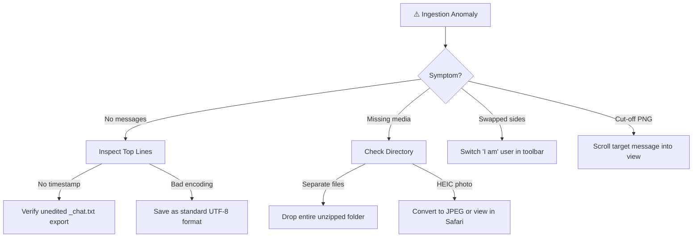

# 🛠️ Troubleshooting Guide & Diagnostic FAQ

Common questions, unexpected behaviors, and fast solutions for **WhatsApp Chat Viewer**.

---

## 1. Fast Diagnostic Flowchart



---

## 2. Quick Troubleshooting Matrix

| Symptom | Probable Cause | Immediate Solution |
| :--- | :--- | :--- |
| **"No messages were recognised"** | Uploaded file is not a valid WhatsApp chat export or was heavily altered. | Verify the first line begins with timestamps like `[DD/MM/YY, HH:mm:ss]` or `DD/MM/YYYY, HH:mm -`. |
| **Images say "File not uploaded"** | The `.txt` was dropped without its corresponding image files, or filenames were altered. | Highlight both `_chat.txt` and image files together, or drop the entire unzipped folder onto the browser. |
| **"Preview not supported by browser"** | The image is an Apple `.heic` file, which Chromium/Firefox cannot decode natively. | Export in standard JPEG/PNG format, or view using Safari on macOS. |
| **Sent / Received sides are swapped** | The parser assigned the other participant as "you". | In the toolbar ribbon, click the **"I am"** dropdown and select your name/phone number. |
| **Dates look inverted (month vs day)** | Dates are within 1-12 range without later disambiguating dates. | If no day > 12 exists, format defaults to `DD/MM`. Dates will still sequence chronologically. |
| **Screenshots are cut off or scrolled** | `Download Screenshot` captures the currently visible viewport. | Scroll the chat container to the exact section you want to capture before clicking "Download Screenshot". |

---

## 3. Platform & Export FAQs

### Can I drop a `.zip` file directly?
Currently, `.zip` files must be extracted first. Drag-and-drop the unzipped folder directly onto the drop zone; the app will scan through all files and subdirectories automatically.

### Why do some emojis appear differently?
Emojis are rendered using your device's native system fonts (Apple Color Emoji on macOS/iOS, Segoe UI Emoji on Windows, Noto Color Emoji on Android/Linux).

### Does the app store any data on the server?
**No.** All file parsing, object URL generation, and screenshot rendering occur strictly inside your local browser instance. Zero network telemetry.

---

## 4. Developer & Terminal FAQs

### PowerShell execution policy error running `npm`
On Windows, PowerShell may block `.ps1` execution scripts.
* **Fix:** Use `npm.cmd` instead (e.g. `npm.cmd run dev`), or update execution policy:
  ```powershell
  Set-ExecutionPolicy -Scope CurrentUser RemoteSigned
  ```

### How do I run automated benchmarks?
Run the built-in stress-test benchmark suite:
```bash
npm run benchmark
```
This tests parsing throughput from 1,000 to 100,000 messages and verifies ReDoS security bounds.
