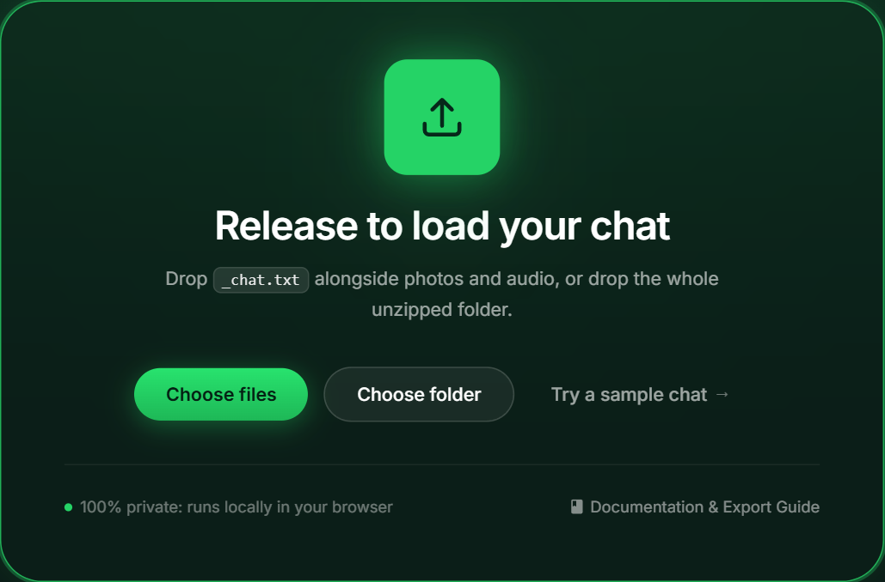
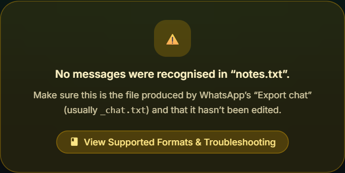
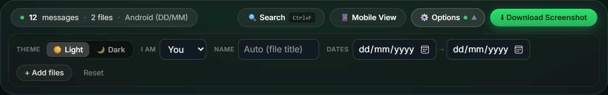
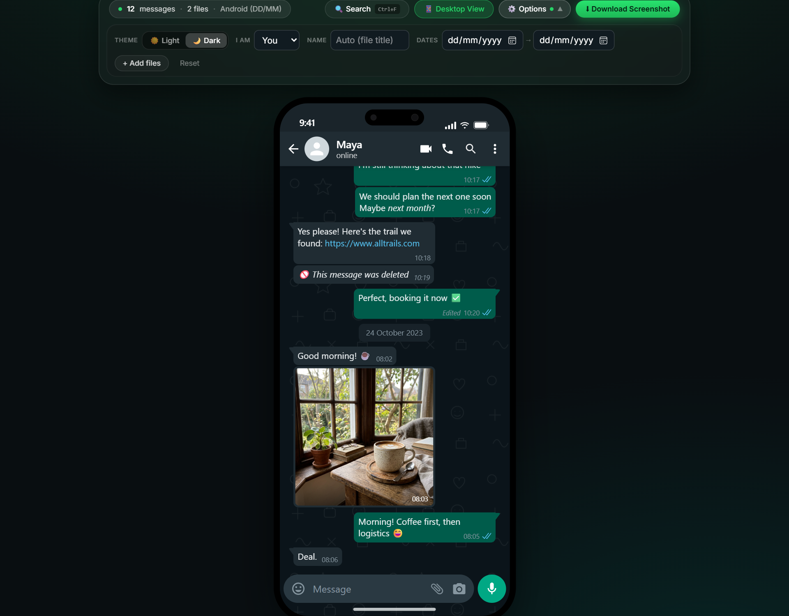
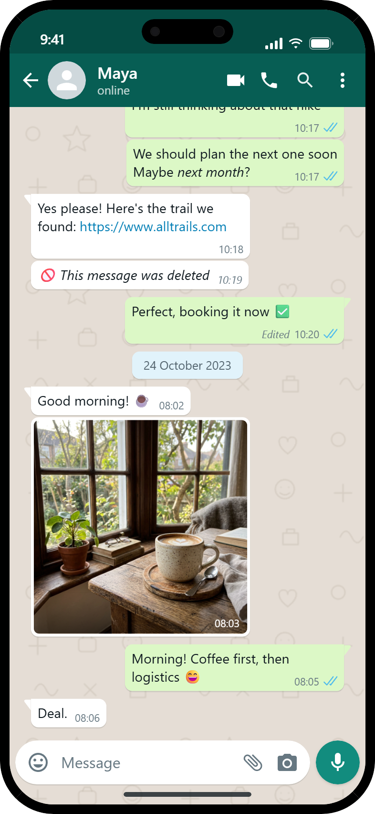
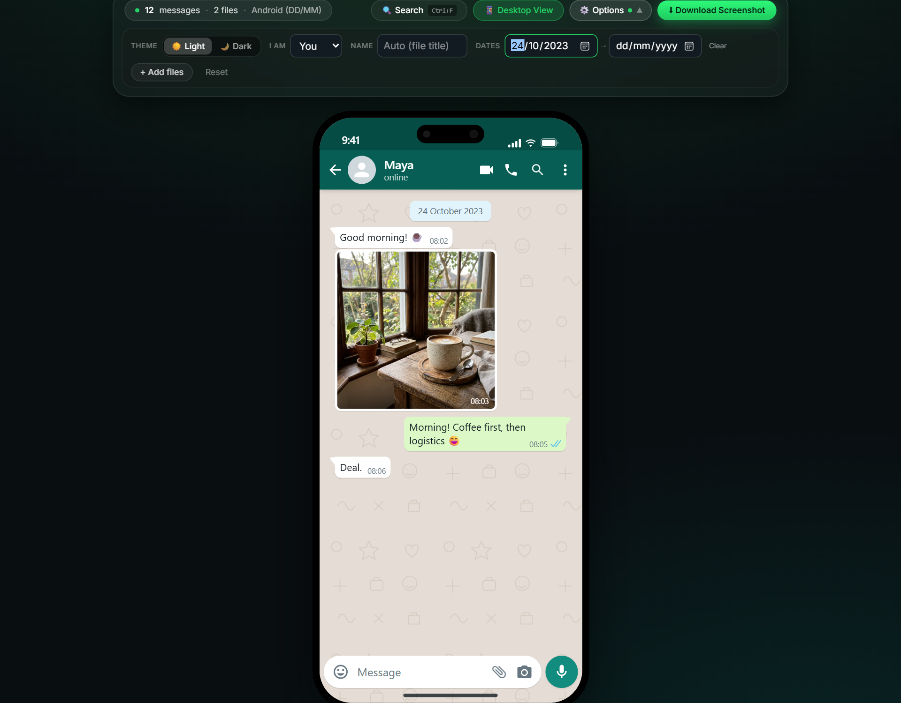
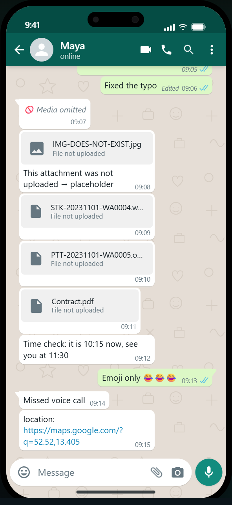

# User guide

Everything you need to go from "I have a WhatsApp chat" to "I have a beautiful screenshot".

**Contents**

1. [Exporting a chat from WhatsApp](#1-exporting-a-chat-from-whatsapp)
2. [Loading it into the viewer](#2-loading-it-into-the-viewer)
3. [Screen-by-screen tour](#3-screen-by-screen-tour)
4. [Step-by-step workflows](#4-step-by-step-workflows)
5. [Reading the chat correctly](#5-reading-the-chat-correctly)
6. [Tips for great screenshots](#6-tips-for-great-screenshots)
7. [Keyboard & pointer cheatsheet](#7-keyboard--pointer-cheatsheet)

---

## 1. Exporting a chat from WhatsApp

### Android

1. Open the chat → tap **⋮** (top right) → **More** → **Export chat**.
2. Choose **Include media** (or *Without media* for text only).
3. Share/save the resulting **`.zip`** (Google Drive, e-mail, "Save to device"…).
4. On your computer, **unzip** it. You get `WhatsApp Chat with <Name>.txt` plus `IMG-…jpg`, `VID-…mp4`, `PTT-…opus`, `STK-…webp` files.

### iPhone

1. Open the chat → tap the **contact/group name** → scroll down → **Export Chat**.
2. Choose **Attach Media** (or *Without Media*).
3. Save to **Files** / AirDrop / e-mail it to yourself. You get a `.zip`.
4. **Unzip** it. You get **`_chat.txt`** plus `00000012-PHOTO-2023-10-23-10-15-30.jpg`-style media files.

> [!TIP]
> **Media Export Limits:** WhatsApp limits exports with media to roughly the last 10,000 messages (and 40,000 without media). Large attachments (videos) make exports big — exclude media if you only need text.

> [!NOTE]
> **Why unzip first?** Browsers cannot stream zip archives natively without heavy libraries. Unzipping keeps everything on your local machine with 100% privacy and lightning-fast speed.

---

## 2. Loading it into the viewer

You have four equivalent ways. Pick whichever is most convenient; you can combine them freely.

| Method | How |
| --- | --- |
| **Drag & drop files** | Select `_chat.txt` **and** all photos/videos in your file manager and drop them anywhere on the page. |
| **Drag & drop the folder** | Drop the whole unzipped folder – sub-folders are scanned recursively. |
| **Choose files / Choose folder** | Buttons on the landing page. |
| **Add files** | After a chat is open, the toolbar's **+ Add files** button (or just drop more files anywhere). |

Things worth knowing:

* If you drop several `.txt` files, the one named `_chat.txt` / `WhatsApp Chat …` wins.
* Media can arrive **before, with, or after** the chat file – attachments are linked automatically as soon as they're available.
* Files such as `.DS_Store` / `Thumbs.db` are ignored.
* **Reset** clears everything from memory and revokes all temporary blob URLs.

Don't have a chat? Click **Try a sample chat** or use the files in [`samples/`](../samples/README.md).

---

## 3. Screen-by-screen tour

### 3.1 Landing page – the drop zone

| # | Element | Purpose |
| - | --- | --- |
| 1 | **Drop zone card** | Drop files/folders anywhere on the page. The card highlights while you drag. |
| 2 | **Choose files** | Classic file picker (multi-select). |
| 3 | **Choose folder** | Folder picker – selects every file inside. |
| 4 | **Try a sample chat** | Loads a built-in demo chat *with real photos*, great for exploring. |
| 5 | **Privacy note** | Reminder that nothing leaves your browser. |
| 6 | **3-step strip** | Export → Drop → Share cheat-sheet. |

While you drag a file over the page the drop zone lights up:

If something goes wrong (e.g. you dropped a random `.txt`), you get a helpful message instead of a blank screen:

### 3.2 The chat page (desktop layout)

The page has three zones: **toolbar** (top), **chat window** (middle) and a small tip line (bottom).

### 3.3 The toolbar

**Row 1 – Status & Primary Actions**

| Control | Description |
| --- | --- |
| **Status badge** | Displays message count, media count, export format (`iOS` or `Android`), and date order (`DD/MM` or `MM/DD`). |
| **Missing media tag** | Alerts you in amber when attachments referenced in text are missing from the uploaded folder. |
| **🔍 Search** | Opens the header search engine with real-time match counters (`1 of N`) and diacritic folding (<kbd>Ctrl+F</kbd> / <kbd>Cmd+F</kbd>). |
| **Docs & Help** | Opens the interactive In-App Documentation spotlight modal (<kbd>?</kbd>) with live search and export timelines. |
| **📱 Mobile View** | Switches between the desktop chat window and an authentic **393 × 852 px** iPhone 15/16 Pro frame with Dynamic Island. |
| **⚙️ Options** | Toggles the secondary customization ribbon open/closed for a clean, distraction-free interface. |
| **⬇ Download Screenshot** | Generates a 2× retina PNG with automatic off-screen DOM culling in under 250ms. |

**Row 2 – Apple Studio Ribbon (Customization & Filters)**

| Control | Description |
| --- | --- |
| **Theme** | Switches between **Light** (classic WhatsApp beige) and **Dark** themes. |
| **I am** | Sets your perspective in the chat. Your messages appear on the right in green with blue delivery ticks. |
| **Name** | Overrides the contact name in the header to anonymize conversations before screenshot capture. |
| **Dates** | Filters messages to a specific start and end date range. Click **Clear** to remove filters. |
| **+ Add files** | Adds more media or photos at any time without reloading the page. |
| **Reset** | Clears the session from memory and revokes all active temporary blob URLs synchronously. |

### 3.4 The Chat Window & Navigation

| Part | Description |
| --- | --- |
| **Header** | Displays contact avatar, conversation name, call actions, and authentic Apple Dynamic Island + status bar in Mobile View. |
| **Wallpaper** | Official WhatsApp doodle pattern on `#E5DDD5` (light) or `#0B141A` (dark). |
| **Date chips** | Groups messages by day with centered badges (*e.g., 24 October 2023*). |
| **System notices** | Displays end-to-end encryption notices, admin actions, and participant joins/leaves. |
| **Incoming bubbles** | White, left-aligned bubbles with speaker name colors in group chats. |
| **Outgoing bubbles** | Green `#DCF8C6`, right-aligned bubbles with timestamps and blue double ticks. |
| **Floating Jump Button** | A circular button (`↓`) appears when you scroll up, allowing you to jump back to the latest messages smoothly. |
| **Windowed Pagination** | Renders 400 messages at a time; click **Load earlier messages** to expand history safely without crashing browser memory. |

### 3.5 Mobile View (light / dark)

  
  &nbsp;&nbsp;&nbsp;&nbsp;
  

* The frame is **exactly 393 × 852 px** – the border is part of those dimensions (CSS `box-sizing: border-box`).
* On the page it looks like this:

### 3.6 The downloaded screenshot

`Download Screenshot` produces a **2× resolution PNG** (786 × 1704 px in Mobile View) with transparent rounded corners:

### 3.7 Date-range filter

Pick a *from* and/or *to* date to focus on a conversation slice. The chat jumps to the end of the selected range.

---

## 4. Step-by-step workflows

### A. "I want a phone screenshot of a specific moment"

1. Load the chat (+ media).
2. Set **I am** so your side is right.
3. (Optional) set **Dates** to the day you need – this also shortens the scroll.
4. Click **Toggle Mobile View**.
5. Scroll so the exact bubbles you want are visible.
6. Click **Download Screenshot**.

### B. "I need to hide names / phone numbers"

1. Type a neutral label in **Chat name** (e.g. *Friend*). The header changes immediately.
2. Names inside the bubbles of **group chats** and phone-number senders come from the text file. Edit the `.txt` in any
   editor (find & replace the name) **before** dropping it – the viewer shows exactly what the file says.

### C. "My export came without media"

Nothing to do – `<Media omitted>` lines are rendered as *🚫 Media omitted*. If you later export **with** media, drop the new
files; the placeholders turn into real photos.

### D. "The export is huge (50 000 messages)"

Parsing takes about a quarter of a second. Only the latest 400 messages are rendered; use **Dates** to jump to a period or
click **Load 400 earlier messages** repeatedly.

### E. "I have many media files but chat has few"

Extra files are simply ignored – only files named in the chat are used.

### F. "Switch whose side is whose"

Use **I am**. Everything re-renders instantly; no re-upload needed.

---

## 5. Reading the chat correctly

These are the special renderings you may see (try [`samples/edge-cases`](../samples/README.md#edge-cases)):

| You see | Meaning |
| --- | --- |
| 🚫 *This message was deleted* | The sender deleted it (the export contains that notice). |
| *Edited* before the time | The export marked the message `<This message was edited>`. |
| 🚫 *Media omitted* | The chat was exported **without media**. |
| Grey card "**File not uploaded**" | The chat references a file you didn't drop. Check the name shown and drop it. |
| Card "Preview not supported by this browser" | The file exists but the browser can't decode it (typically `.heic`). |
| Paperclip card with a file name | A document (PDF, vCard…) – click to download it from memory. |
| 🎤 *Voice message* + player | `PTT-….opus` / iOS audio notes. |
| Large image without bubble | A sticker (`STK-….webp`). |
| Coloured name above bubbles | Group chat sender. |
| Yellow pill with lock | The end-to-end encryption notice. |

---

## 6. Tips for great screenshots

* Use **Mobile View**: it matches phone aspect ratios used in social media and docs.
* Choose **Dark** for dark-themed slides/blogs.
* Scroll first, capture second – the PNG is exactly what you see.
* Make the browser window at least ~900 px tall in desktop layout, otherwise the window is capped at its minimum height.
* The PNG has transparent corners – drop it on any background.
* Browser zoom doesn't affect the PNG (it is rendered at fixed 2× scale).

---

## 7. Keyboard & pointer cheatsheet

| Action | Shortcut / Gesture |
| --- | --- |
| **In-Chat Search** | <kbd>Ctrl + F</kbd> (Windows/Linux) or <kbd>Cmd + F</kbd> (Mac) |
| **Next Search Match** | <kbd>Enter</kbd> (cycles to next match and auto-scrolls) |
| **Previous Search Match** | <kbd>Shift + Enter</kbd> (cycles to previous match) |
| **Close Search / Close Modals** | <kbd>Esc</kbd> |
| **Open In-App Documentation** | <kbd>?</kbd> (Question mark) |
| **Add more files** | Drag and drop them anywhere on the browser window |
| **Activate toolbar button** | <kbd>Tab</kbd> to focus, <kbd>Enter</kbd> or <kbd>Space</kbd> to activate |
| **Scroll the chat** | Mouse wheel / trackpad / <kbd>↑</kbd> <kbd>↓</kbd> <kbd>PgUp</kbd> <kbd>PgDn</kbd> |
| **Toggle mobile view** | Click **Mobile View** in the toolbar |

Need help? Check [Troubleshooting](TROUBLESHOOTING.md) or [Benchmarks](BENCHMARKS.md).
